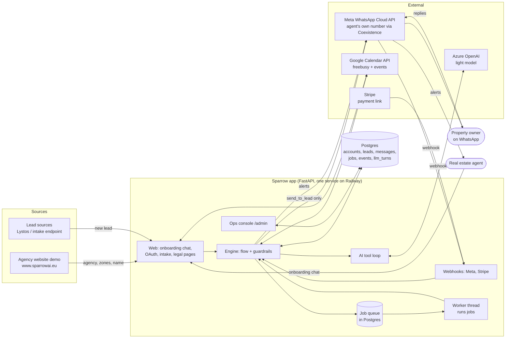
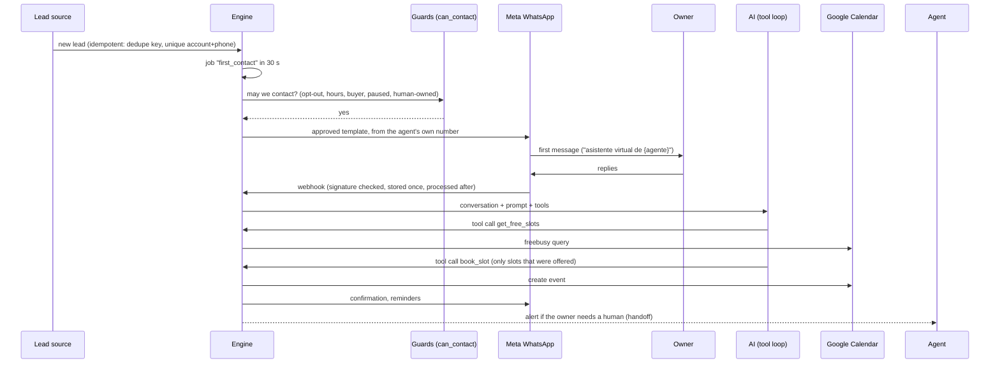
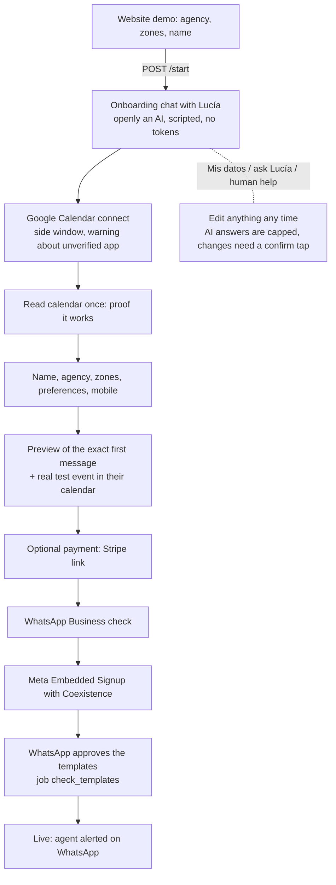

# Sparrow AI: how the system works

A WhatsApp AI assistant for independent real estate agents in Spain. A new lead (a private seller who published a listing) gets a WhatsApp from the agent's own number within 30 seconds. The AI talks to the seller in Spanish and books a valuation in the agent's Google Calendar. Pricing: €90 one-time per agent, €30 per booked meeting.

This page is written to be pasted into a diagram tool (it includes ready-made Mermaid diagrams and a prompt at the end).

## 1. The big picture

## 2. Life of a lead

## 3. Agent onboarding (one hands-on conversation, then hands-off)

## 4. Components (code map)

| File | Responsibility |
|---|---|
| `app/engine.py` | The flow and all job handlers. `send_to_lead()` is the only way to message a lead |
| `app/guards.py` | `can_contact()` single gate, allowed hours, 24 h window |
| `app/prompt.py` | The seller conversation script (system prompt) |
| `app/llm.py` | AI tool loop and tool schemas; Azure OpenAI by default, OpenAI or Claude possible; scripted fake for tests |
| `app/helpchat.py` | Capped AI help for the onboarding (questions, screenshots, change proposals) |
| `app/templates.py` | All WhatsApp template names and texts |
| `app/whatsapp.py`, `app/gcal.py` | Meta Cloud API and Google Calendar clients, each with a real and a fake version |
| `app/webhooks.py` | Meta and Stripe webhooks: signature check, store once, process after |
| `app/web.py`, `app/onboarding.py` | Onboarding API and steps, Google OAuth, lead intake, legal pages |
| `app/jobs.py` | Job queue in Postgres, with retries and recovery of stuck jobs |
| `app/admin.py` | Ops console |
| `app/crypto.py` | Encrypts per-agent tokens at rest |

Data model: `accounts` (one per agent), `integrations` (google, meta, stripe; tokens encrypted), `leads`, `messages` (every message logged), `webhook_events`, `jobs`, `meetings`, `llm_turns` (every AI turn logged), `events` (funnel log).

## 5. Safety rules (each has a test)

- Every outbound message to a lead goes through one function and one gate (`send_to_lead` then `can_contact`).
- Opt-out ("BAJA") is permanent. Buyers, hot-stage leads and "no AI" tags are never contacted.
- Outside allowed hours the first message waits for the morning. Free text is never sent outside WhatsApp's 24 h window (templates only).
- The AI never writes lead state. Only tools and code do, and the booking tool only accepts slots that were offered. Any AI or tool error hands the chat to the agent (fail closed).
- If the agent writes to a lead after the lead replied, the AI stops for that lead until resumed.
- The AI always introduces itself as "el asistente virtual de {agente}" and never claims to be human.
- Never read or answer chats with contacts that are not leads.
- Webhooks and intake are idempotent. Every message and every AI turn is logged.
- AI usage is capped per lead (day and week), per agent (circuit breaker) and per message length. At the cap, the chat goes to the agent and the model is not called.
- Google tokens are deleted automatically within a day if the agent revokes access.
- Onboarding AI help is capped (40 messages per agent) and never changes data without a confirm tap.

## 6. Tech and deployment

Python 3.11, FastAPI, SQLAlchemy, Jinja templates, plain JavaScript front end (no build step), Postgres (SQLite in dev and tests). One Docker service on Railway runs the web server and the job worker; deploys from GitHub `main`. A second preview service deploys a branch in fake mode (no real WhatsApp, Google or AI). 59 tests, using fakes for WhatsApp, Calendar and the AI, and a frozen clock.

## 7. Prompt for a diagram tool

> Using the architecture below, draw one clean system diagram for a non-technical audience of hiring managers. Show: the real estate agent, the property owner, the website demo, the Sparrow app (web, engine with guardrails, job queue, worker, AI loop), Postgres, and the external services (Meta WhatsApp, Google Calendar, Azure OpenAI, Stripe). Highlight the single gate every outgoing message passes through, and the fact that the AI can only act through tools. Use a left-to-right flow and short labels. Then draw a second, simple timeline of what happens from "new lead" to "valuation booked". Keep the style flat, with warm neutral colors.
